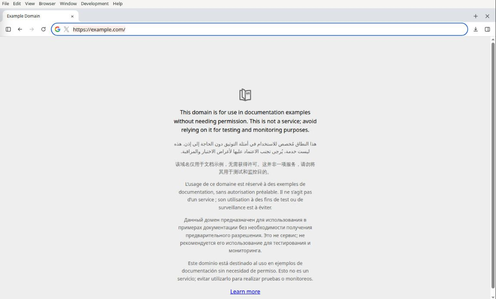
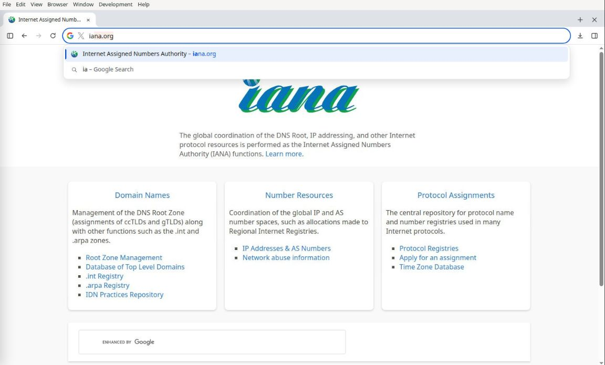

# Mia 0.2.19 release candidate

## Source scope

The candidate builds on browser PR #50 through b6cd3d6 (including 17c2ae1),
with explicit-address preservation, screenshot lifecycle and delayed-history
fixes. It also includes PR #49's unused Contacts permission removal and the
per-turn Google connection/tool refresh requested for Mia and bots. `macos/package.json` is authoritative and the lockfile agrees.

The first browser owner fix wave ends at ec254b2; Google tool visibility is
94bd43f, address suggestions c97781e, and the address-row bots control b6cd3d6.
Resolved actor identity, independent bot tab ownership, preserved chat choice,
and positively acknowledged cancellation remain release criteria.

## Acceptance and release gates

1. Verify the combined frontend, backend, native browser, runtime cancellation
   and packaging contracts. Regression tests must fail the relevant baseline.
2. In the actual desktop app, verify no pink strip mote, the address-row Your
   bots drawer, selecting another chat/tab while the previous one opens, and
   current-page popup images during typing, dismissal, reopening and navigation.
   Explicit HTTPS plus HTTP history must keep HTTPS on Enter. Escape must restore
   the latest genuine edit after cold/out-of-order history responses.
3. Verify real Mia and bot replies, separate bots using distinct browser groups,
   denied actor lookup, and successful/failed cancellation/takeover. Fixtures
   prove local contracts, not installed/native acceptance.
4. Review and merge the complete intended source; freeze the exact main SHA.
   No release build from a dirty or unmerged source tree.
5. Preflight native Mac/Windows and supported Linux runtimes, disk, pinned
   runtime provenance and signing/notarization inputs. Build all three fresh
   distributions. Preserve installed profiles and existing files.
6. Test installed candidates; arrange the independent Daybreak source/package
   review for the frozen SHA. Report blocked gates rather than assuming a pass.
7. Stage and verify complete draft assets, feeds, stable aliases and checksums.
   Publication is a separate owner approval. After publication, verify public
   stable downloads and installed OTA delivery on Mac and Windows.

This document records the required train, not completed native acceptance,
merge, build, upload, publication or OTA verification.

## Candidate source verification (2026-10-19)

- Frontend: 319 automated tests passed, including explicit HTTPS, delayed
  history/keyboard restoration and screenshot lifecycle regressions. The new
  regression cases fail their earlier source baselines.
- Backend: 562 passed, 3 optional fixture tests skipped. Packaging contracts:
  34 passed, 2 platform/runtime-dependent tests skipped.
- Desktop source tests: 219 passed after correcting a pre-existing startup
  assertion that expected a single-line conditional. Startup application code
  was unchanged by that test correction.
- Native Linux dev candidate using the existing QA profile/keyring in place:
  real Mia and bot responses rendered; no pink mote in the strip; address-row
  bots drawer opened; HTTP-history completion preserved HTTPS on Enter;
  Escape restored actual typing; reopened suggestions showed the current
  page after switching sites. The original installed app was quit normally;
  no authentication or Electron sandbox override was used.
- Manual testing exposed a blank-background capture during repeated suggestion
  replacement. The final fix retains the current cover until replacement
  suggestions are ready, with a regression and native recheck.
- Independent source review found no remaining blocker in the autocomplete
  changes. Source checks do not establish installed candidate, concurrent
  multi-bot/takeover acceptance, native Mac/Windows acceptance or OTA delivery.

## Connection changes included in the train

Every dispatched Mia/bot turn receives the authorized owner's current Google
connection/account/access and configured tool catalog. Connection, grant,
account, access or runtime changes alter the capability revision, invalidating
older resume bindings. A busy turn is steered only under the same revision;
otherwise the new message waits for a fresh dispatch. The current snapshot is
still supplied when unchanged; the bounded revision cache is informational.

The Google MCP server keeps the short `google` name and directly exposed tool
catalog. Full Google profiles retain the normal guarded terminal/browser
integration. This does not change the deliberately trusted full default Hermes
CLI toolset into a connector-only sandbox. Snapshot data excludes credentials,
raw provider responses and message contents. Tool configuration is not proof
of a registered tool or a successful external action.

The requested grant is openid, userinfo.email, gmail.modify, calendar.events
and drive.file. Removing Contacts does not revoke an older Google grant;
existing users may still have an earlier permission until they revoke it.

Source review and unit coverage include connection replacement/disconnect,
owner isolation, non-English follow-ups, resume invalidation and busy steering.
A final native connected-account turn remains required after this integration;
no new claim of a completed OAuth replacement or external Google action follows
from the fixture tests alone.
